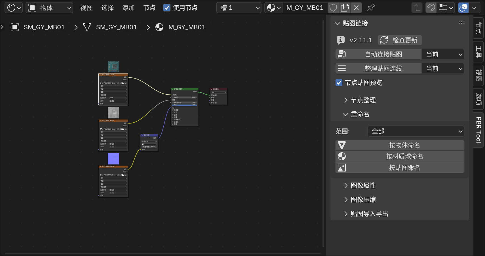

# TextureLink v2.11.3

在 Blender Shader Editor 里一键搞定贴图连线、重命名、清理、压缩、批量导入。把繁琐的节点操作交给插件。

**v2.11.3 更新**　修复批量缩放时滑块显示 0.50、2048×2048 贴图却缩成 1032×1032 的问题。在默认最小分辨率下，结果为 1024×1024。更新栏也已与资产导出插件统一。

**v2.11.1 更新**：可按物体、材质球或贴图名称一次统一整套资产的命名。着色器编辑器内置贴图缩略图，支持独立整理已有连线；压缩后保留原图路径和打包像素。

从 [GitHub Releases](https://github.com/Neocvsu-commits/Blender-TextureLink/releases/latest) 下载 `TextureLink.zip`，在 Blender 的插件偏好设置中选择“从磁盘安装”，然后启用“贴图链接”。

**v2.8.1 更新**修复批量导入时相似材质名导致的贴图错连。有精确匹配时，只载入对应材质的贴图。没有精确匹配时，回退到模糊匹配。

**v2.8.0 更新**：贴图识别不再要求通道字段必须在文件名结尾。`RedRoot_BaseColor_2048`、`RedRoot_ARM_2048`、`RedRoot_Normal_OpenGL_2048` 这类 AI 生成命名（字段在中间、分辨率在最后）也能正确连线和命名；批量匹配文件夹贴图同样先剔掉通道字段再对齐材质名；法线标注 DirectX 时会在状态栏提示 G 通道需翻转。

## 解决的问题

拿到一堆贴图手动往 Principled BSDF 上拖、调色彩空间、删无用节点——一套材质做下来光连线就耗掉不少时间。多人协作时命名不统一，交接后还得逐个改。

这个插件根据贴图后缀自动识别通道、连线、修正色彩空间。支持批量导入外部贴图、压缩贴图体积、材质和贴图命名互相对齐。

## 基本信息

| 项目 | 内容 |
| :--- | :--- |
| 插件版本 | 2.11.3 |
| Blender 支持 | 3.4.0+ |
| 主力版本 | Blender 4.2 LTS、4.5 LTS |
| 入口 | Shader Editor > 侧栏（N）> PBR Tool |

## 核心功能

### 🔧 贴图连接

**自动连接贴图** — 识别贴图命名字段，接到 Principled BSDF 对应输入口。字段可以出现在文件名的任意位置，末尾的分辨率（`_2048`、`_4k`）、朝向标记（`_OpenGL` / `_DirectX`）不影响识别：`Rock_BaseColor_2048.png`、`BaseColor_Rock_2048.png`、`T_Rock_d.png` 都会认成底色。颜色通道自动设 sRGB，数据通道（法线、粗糙度等）设 Non-Color。如果工程里已有 Normal Map、Separate Color、MixRGB 等中间节点，会优先复用。

支持的复合图逻辑：
- `ORM` / `ARM`：R=AO，G=Roughness，B=Metallic
- `RMA`：R=Roughness，G=Metallic
- 独立 `AO`：通过乘法叠加到底色链路

**整理贴图连线** — 用于已经接好线的材质。在 **PBR Tool → 贴图链接** 中点击后，UV 和映射节点排在左侧，贴图与中间处理节点按实际接入的材质通道排列。未接线的贴图按可识别的名称分开排列，节点框内的贴图保留在原框。支持 Ctrl+Z。

**检查更新** — 侧栏和插件偏好设置顶部左侧显示版本号，右侧按钮显示检查状态。点击按钮可重新检查，有新版时下方会出现“更新至 v…”和“更新说明”。

**清除无用节点** — 删掉未连接到最终输出的孤立节点。

**重置材质节点** — 材质还原为基础白板，只保留 Principled BSDF 和 Material Output。

### 🏷️ 命名规则

在 **PBR Tool → 重命名** 中选择范围。“当前”处理活动物体，“全部”处理所有选中的物体。点击任意一个按钮，即可统一物体、网格、材质和贴图在 Blender 中的名称。

| 按钮 | 名称来源 |
| --- | --- |
| 按物体命名 | 物体名称 |
| 按材质球命名 | 活动材质槽中的材质球名称 |
| 按贴图命名 | 优先使用活动材质中选中的图像纹理节点，其次使用底色贴图 |

例如，选中 `T_GY_MB01_D.png` 后点 **按贴图命名**，物体和网格会命名为 `SM_GY_MB01`，单材质命名为 `M_GY_MB01`，法线贴图命名为 `T_GY_MB01_N.png`。有多个材质时，按材质槽顺序追加 `_A`、`_B` 等标记，各材质的贴图沿用对应标记。

后缀推断规则：

| 推断后缀 | 连接含义 |
| :--- | :--- |
| `_ORM` | 经 Separate Color 后，绿接 Roughness、蓝接 Metallic。即使红仍接 glTF Occlusion，也按 ORM 整张贴图命名 |
| `_AO` | 独立 AO 图参与底色相乘，或分离出的红通道单独接入外置 Occlusion |
| `_Alpha` | 连接至 Principled BSDF 的 Alpha 输入 |
| `_D` / `_N` / `_R` / `_M` | 分别对应 Base Color、Normal（经 Normal Map）、Roughness、Metallic 直连链路 |

### 🖼️ 图像预览

打开着色器编辑器，展开的图像纹理节点上方会显示缩略图。上方空间不足时，预览会移到节点左侧。两个位置都被占用或视图缩得过小时，插件会收起缩略图。关闭侧栏后也能看到预览，可在 **PBR Tool → 贴图链接** 中切换。

节点缩略图支持静态文件、已打包的静态贴图和 Blender 生成的图像。选中节点并展开侧栏的 **图像属性**，可查看图像、替换贴图、修改色彩空间和 Alpha 模式。序列、影片和 UDIM 继续使用侧栏预览。

### 📦 图像压缩

**应用处理** — 按范围缩放贴图，支持跨中间节点追溯（Separate Color、Normal Map 等）找到实际贴图。

压缩参数：
- `压缩比例`按面板显示的两位小数计算。在默认最小分辨率下，2048×2048 的贴图按 0.50 缩放后为 1024×1024。
- `最小分辨率`：防止缩得过小
- `格式转换`：JPEG / PNG / TGA / TIFF / BMP / EXR

缩放或转换格式后，插件将处理后的像素打包进 Blender，并保留原图路径。未保存工程时，NodePreview 也可以通过该路径读取预览。默认压缩不会覆盖磁盘原图。

**贴图导入导出 → 打包导出贴图** — 把已连接贴图导出到指定目录。支持所选和全场景两个范围。优先从内存像素写出（覆盖缩放/格式转换后的状态），回退到磁盘源文件兜底。导出后可点 `打开导出目录` 查看文件。

### 📥 外部批量导入

点 `匹配文件夹贴图`，插件按材质名推导贴图前缀并在目录中匹配文件：
- `M_Weapon` → 匹配 `T_Weapon_*`
- `weapon`（小写）→ 匹配 `T_weapon_*`（不区分大小写）
- `Weapon` → 匹配 `T_Weapon_*`

## 贴图后缀速查

| 通道 | 可识别字段 |
| :--- | :--- |
| Base Color | `basecolor`、`albedo`、`diffuse`、`diff`、`color`、`col`、`bc`、`d` |
| Normal | `normal`、`normalmap`、`nor`、`nrm`、`n` |
| Roughness | `roughness`、`rough`、`rgh`、`r` |
| Metallic | `metallic`、`metal`、`met`、`m` |
| AO | `ao`、`ambientocclusion`（`ambient occlusion` 同样识别）、`occlusion` |
| Alpha | `alpha`、`opacity`、`a` |
| ORM/ARM | `orm`、`orm_0`、`orm_1`…（`orm` + 数字）、`arm`、`ao_r_m` |
| RMA | `rma` |

识别时不区分大小写，也不要求字段在结尾：`_`、`-`、空格分隔或直接连写（`WeaponBaseColor`）都能拆开。`_d`、`_n`、`_r`、`_m`、`_a` 这类单字母只认最后一个字段位，所以 `RedRoot` 里的 `r` 不会当成 Roughness。交付建议统一输出大写后缀（`_D`、`_N`、`_R`、`_ORM`、`_AO`）。

## 常用流程

**乱节点工程整理**：选中模型 → 清除无用节点 → 自动连接贴图 → 按贴图命名。

**批量导入烘焙贴图**：选中目标物体 → 贴图导入导出 → 匹配文件夹贴图 → 选贴图目录。

**交付前压缩**：在“图像压缩”设定压缩比例和目标格式 → 应用处理 → 在“贴图导入导出”中打包导出贴图。

**统一命名**：选中待处理的模型，在“重命名”中点选名称来源。需要同步源文件时，再到“贴图导入导出”点击“重命名并写回磁盘”。

## FAQ

**Q1：自动连接贴图有些图没反应？**
只对能识别字段、或可追溯到有效通道的图生效。插件不会猜测未知用途的贴图，安全优先。名字里没有任何通道字段（例如只有 `RedRoot_2048.png`）的图会被跳过。

**Q2：清除无用节点删了还能恢复吗？**
可以 Ctrl+Z 撤销。它只删未连到输出链路的节点。

**Q3：执行压缩后原贴图文件会被覆盖吗？**
不会。默认只修改 Blender 内部 packed 数据，不写磁盘原图。开启「同步到磁盘」才会覆盖，且格式不同时会自动删除旧格式文件。

**Q4：打包导出贴图能 Ctrl+Z 撤销吗？**
不能。文件系统写入不在 Blender 撤销栈里。导出前确认目录。

**Q5：如何同步磁盘上的贴图名称？**
三个命名按钮默认只调整 Blender 数据块名称。“贴图导入导出 → 重命名并写回磁盘”可同步外部文件和路径。

**Q6：贴图连接里的"全部"和导出里的"全场景"范围一样吗？**
不一样。贴图连接中的"全部"= 所选物体材质，导出中的"全场景"= `bpy.data.materials`。两处定义不同。

**Q7：旧工程里的 `MI_` 材质名怎么办？**
选择“按材质球命名”即可将旧前缀转为 `M_`，并统一该物体的网格和贴图名称。

**Q8：AI 生成的贴图名字很长，还能识别吗？**
能。字段按词匹配，不看位置和分隔符，末尾的分辨率、`OpenGL` / `DirectX` 这类朝向词都会被跳过，所以 `RedRoot_BaseColor_2048.png`、`BaseColor-RedRoot-2k.png`、`RedRoot_Normal_OpenGL_2048.png` 都可以直接连线。

**Q9：法线是 DirectX 版本怎么办？**
插件只识别、不擅自翻通道。状态栏提示「DirectX 法线，G 通道需翻转」时，给该贴图把 G 通道反相，或改用同一套的 OpenGL 版本，否则凹凸方向会反。
